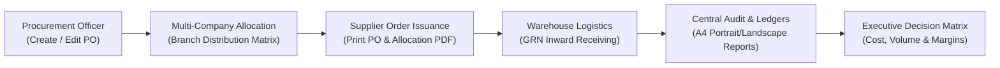

# ASB Fashion — Purchase Order Management & Supply Chain Audit System

[](#)
[](#)
[](LICENSE)
[](#intellectual-property--authorship)
[](#license--maintenance-mandate)

An enterprise-grade, high-throughput **Purchase Order (PO), Multi-Company Inventory Allocation, Goods Received Note (GRN) Inward Processing, and Audit Ledger System** built exclusively for **ASB Group of Companies (ASB Fashion)**.

Designed and engineered from the ground up by **Kavindu Bogahawatte** and **VEXEL IT (kavizz)**, this platform serves as the central operational backbone for procurement, warehouse distribution, logistics fulfillment, supplier verification, and multi-branch retail distribution across Sri Lanka.

---

## 🏢 Enterprise Scope & Operational Mandate

This software is **strictly proprietary** and licensed exclusively for operational deployment across:
- **Operating Entity:** ASB Group of Companies (ASB Fashion Retail & Supply Chain Network)
- **Technical Custody & Maintenance:** Exclusively managed and maintained by the **ASB Group of Companies IT Department**
- **Sole Architect & Intellectual Property Owner:** **Kavindu Bogahawatte** & **VEXEL IT (kavizz)**

---

## 🌟 Core System Modules & Capabilities



### 1. Purchase Order Lifecycle & Matrix Editor
- **Dynamic PO Authoring (`create_po.php`, `edit_po.php`)**: Full matrix line-item input engine with keyboard-first shortcuts (`Alt+A`, `Alt+S`, etc.), automatic catalog lookup, and live total cost/selling calculations.
- **Real-Time Client Draft Cache**: Auto-saves active matrix entries to browser `localStorage` to safeguard against accidental refreshes or network hiccups with a one-click draft restoration facility.
- **Dual-Table Transaction Integrity**: Concurrently creates, updates, and deletes records across `po_items` and `items` inside ACID-compliant isolated database transactions.
- **Audit Ledger Tracking (`view_pos.php`, `pos.php`)**: Real-time status filtering (`Pending`, `Received`, `Completed`, `Cancelled`) with manager-credential protected status overrides and cascade deletion safeguards.

### 2. Multi-Company & Branch Allocation Engine
- **Multi-Branch Distribution (`allocate_po.php`, `quick_allocation.php`)**: Allows procurement officers to break down bulk PO line-item quantities across multiple sister companies, warehouse hubs, and retail showroom floors.
- **Cross-Location Allocation Summary (`allocation_summary.php`)**: Instant reconciliation verifying that branch allocations match the primary PO target order without over- or under-allocating.
- **Official Allocation Sheets (`print_po_allocation.php`)**: Formats company-wise distribution vouchers for store supervisors and logistics handlers.

### 3. Goods Received Note (GRN) & Inward Receiving Dashboard
- **Receiving Operations Center (`receive_po_dashboard.php`, `get_grn_list.php`)**: Dedicated warehouse floor interface for receiving incoming deliveries, tracking batch numbers, vehicle registration numbers, delivery note vouchers, and driver records.
- **Physical Box/Carton Tracking**: Records carton counts, delivery personnel, and destination floor locations per shipment.
- **GRN Voucher Printing (`print_grn.php`)**: High-contrast printable Goods Received Notes for warehouse gatekeeper authorization and audit filings.

### 4. Master Attribute & Catalog Registry
- **Matrix Attributes Engine (`colors_sizes_manager.php`)**: Centralized management of department categories, sub-departments, colors, sizes, and barcode/system item codes.
- **Catalog Auto-Suggestions (`catalog_suggestions.php`)**: Sub-second search indexing providing auto-fill suggestions for merchandisers.
- **Entity Registries (`companies.php`, `locations.php`, `supplier_module.php`)**: Multi-company corporate directories and vendor profile management linked to central Quality Control databases.

### 5. Executive Audit & Reporting Suite
- **PO Summary Sections Report (`po_summary_sections_report.php`)**:
  - Department and sub-department pivot matrix across order statuses (`Completed`, `Pending`, `Received`, `Cancelled`).
  - Active status filter options (`All (Excluding Cancelled)`, `Pending`, `Received`, `Completed`, `Cancelled`, `All (Including Cancelled)`).
  - Matches official **A4 Portrait** structured report layout with exact subtotals, blank cell formatting for zero values, and overall grand totals.
  - Features dedicated corporate print headers, real-time Sri Lanka server timestamps (`Asia/Colombo`), three-tier verification signature blocks (*Prepared By*, *Checked & Audited By*, *Authorized Approval*), and Excel export integration.
- **Date Range Stock & GRN Audit Report (`date_range_stock_report.php`)**:
  - High-volume paginated inward ledger with batch summaries.
  - Dedicated **Remaining Balance Qty** analysis tracking:
    $$\text{Balance Qty} = \text{PO Total Qty} - \text{Received Qty}$$
  - Printable **A4 Landscape** format cleanly sanitizing hyperlink tags and URL annotations.
  - Official sign-off blocks and corporate footer with Vexel IT by Kavizz attribution.
- **PO Audit Statement (`po_audit_report.php`, `print_po_report.php`)**: Comprehensive order progress verification detailing line-item balances, logistics cargo runs, driver history, and fulfillment rates.

### 6. Security, User Roles & Dynamic Tab Control
- **Dynamic Role Management (`role_management.php`, `tab_management.php`)**: Database-driven navigation tabs mapped dynamically to roles (`Admin`, `User`, `ReceivedUser`).
- **Audit Login Logs (`login_logs.php`)**: Captures user login timestamps, IP addresses, and user-agent strings.
- **Session Security**: Session protection, password hashing, and manager password verification modals for critical operations.

---

## 🗂️ System Directory Architecture

```text
c:\xampp\htdocs\PO_SYSTEM/
├── config/
│   └── database.php                # Database connections (po_system & return_qc)
├── includes/
│   ├── header.php                  # Global top-nav, branding, user badge, responsive CSS
│   ├── sidebar.php                 # Dynamic navigation components
│   ├── footer.php                  # System scripts & closing structures
│   └── functions.php               # Core helper library, session control & SQL helpers
├── api.php                         # Backend RESTful JSON endpoints
├── dashboard.php                   # Executive KPI metrics & navigation center
├── create_po.php                   # PO creation & line item matrix entry
├── edit_po.php                     # Pending PO matrix editor & local draft engine
├── view_pos.php                    # Central PO ledger & managerial override
├── allocate_po.php                 # Multi-company quantity distribution matrix
├── quick_allocation.php            # Rapid allocation engine
├── allocation_summary.php          # Allocation reconciliation & matrix audit
├── receive_po_dashboard.php        # Warehouse GRN receipting operations center
├── print_po.php                    # Standard Purchase Order printable document
├── print_po_allocation.php         # Multi-branch allocation voucher
├── print_grn.php                   # Official Goods Received Note voucher
├── print_po_report.php             # Full lifecycle PO audit statement
├── po_summary_sections_report.php  # Department & sub-department status pivot matrix (A4)
├── date_range_stock_report.php     # Inward stock ledger with Balance Qty tracker (A4)
├── po_audit_report.php             # Master lifecycle verification statement
├── companies.php                   # Corporate entities registry
├── locations.php                   # Warehouse & showroom locations registry
├── supplier_module.php             # Supplier vendor directory
├── colors_sizes_manager.php        # Master matrix attribute registry
├── user_management.php             # User accounts & privilege assignments
├── role_management.php             # Role permissions & access matrix
├── tab_management.php              # Dynamic role-based navigation tab manager
├── login_logs.php                  # Security audit trail & IP tracking
├── login.php                       # Authentication portal
├── logout.php                      # Secure session termination
├── LICENSE                         # Enterprise proprietary software license agreement
└── README.md                       # Master system documentation
```

---

## 🛠️ Technology Stack & System Specifications

| Layer | Technologies |
| :--- | :--- |
| **Backend Runtime** | PHP 8.0+ (Strict mode, prepared statements, MySQLi & PDO) |
| **Database Engine** | MySQL 8.0+ / MariaDB (InnoDB engine, utf8mb4, indexed foreign keys) |
| **Frontend Styling** | Custom ASB Crimson Theme, Tailwind CSS, Bootstrap components |
| **Iconography & Fonts** | FontAwesome 6, Inter, Segoe UI, Roboto system font hierarchy |
| **Client Scripts** | Vanilla JavaScript (ES6+), LocalStorage Cache Engine, Chart.js |
| **Printing & Reports** | Native CSS `@page` print engines (A4 Portrait & Landscape precision) |
| **Timezone** | `Asia/Colombo` (Sri Lanka Standard Time - UTC+5:30) |

---

## ⚙️ Installation & Deployment Guide

### 1. Prerequisites
- **Web Server:** Apache (via XAMPP / WAMP or Linux stack)
- **PHP:** Version 8.0 or higher
- **MySQL / MariaDB:** Version 5.7+ or 8.0+
- **Extensions:** `mysqli`, `pdo_mysql`, `mbstring`, `session`, `json`

### 2. Deployment Steps
1. Place or clone the application directory into your server's web root:
   ```bash
   c:\xampp\htdocs\PO_SYSTEM
   ```
2. Open your MySQL client (e.g. phpMyAdmin, MySQL Workbench, or CLI).
3. Ensure the central databases are created:
   ```sql
   CREATE DATABASE IF NOT EXISTS po_system CHARACTER SET utf8mb4 COLLATE utf8mb4_unicode_ci;
   CREATE DATABASE IF NOT EXISTS return_qc CHARACTER SET utf8mb4 COLLATE utf8mb4_unicode_ci;
   ```
4. Configure database access in [`config/database.php`](config/database.php):
   ```php
   define('DB_HOST', 'localhost');
   define('DB_USER', 'root');
   define('DB_PASS', '');
   define('DB_PO', 'po_system');
   define('DB_QC', 'return_qc');
   ```
5. Launch your browser and navigate to:
   ```text
   http://localhost/PO_SYSTEM
   ```
6. Authenticate using authorized administrative credentials.

---

## 🔒 Security Architecture

1. **SQL Injection Defense**: Strict prepared statements (`bind_param` / parameterized PDO) across all data lookups and transactions.
2. **Managerial Authorization Barrier**: Critical status alterations, cancellations, and order deletions require re-verification with manager security credentials.
3. **Audit Logging**: Full IP logging, session fingerprints, and timestamp tracking on logins.
4. **XSS & Injection Protection**: HTML sanitization (`htmlspecialchars`) and input casting across all reporting, pivot grids, and document renderers.

---

## ⚖️ Intellectual Property & Authorship

```text
========================================================================================
   ASB FASHION PURCHASE ORDER MANAGEMENT & SUPPLY CHAIN AUDIT SYSTEM
   PROPRIETARY INTELLECTUAL PROPERTY & ENGINEERING NOTICE
========================================================================================

Author, Lead Architect & System Owner:
  Kavindu Bogahawatte (kavizz)
  VEXEL IT Solutions

Copyright:
  © 2026 Kavindu Bogahawatte & VEXEL IT. All Rights Reserved.

Permitted Operating Entity:
  ASB Group of Companies (ASB Fashion)

Designated Maintenance Entity:
  ASB Group of Companies — Information Technology Department exclusively
========================================================================================
```

### License & Maintenance Mandate
1. **Ownership**: All source code, database architectures, algorithmic logic, user interface designs, printable report templates, and system workflows are the exclusive intellectual property of **Kavindu Bogahawatte** and **VEXEL IT**.
2. **Operational Authorization**: Licensed solely for internal operational deployment within **ASB Group of Companies**.
3. **Maintenance Scope**: This platform is authorized to be operated, supported, and maintained internally by the **ASB Group of Companies IT Department** strictly in accordance with authorized technical guidelines.
4. **Prohibition of Third-Party Distribution**: No portion of this system may be copied, resold, sublicensed, shared, leased, or distributed outside the official infrastructure of ASB Group of Companies.
5. **Attribution Integrity**: The developer attribution notices (*"Designed & Developed by Vexel IT by Kavizz"*) must remain permanently intact across all page footers, printed documents, code headers, and system documentation.

For technical inquiries or system escalation, contact **Kavindu Bogahawatte** / **VEXEL IT**.
